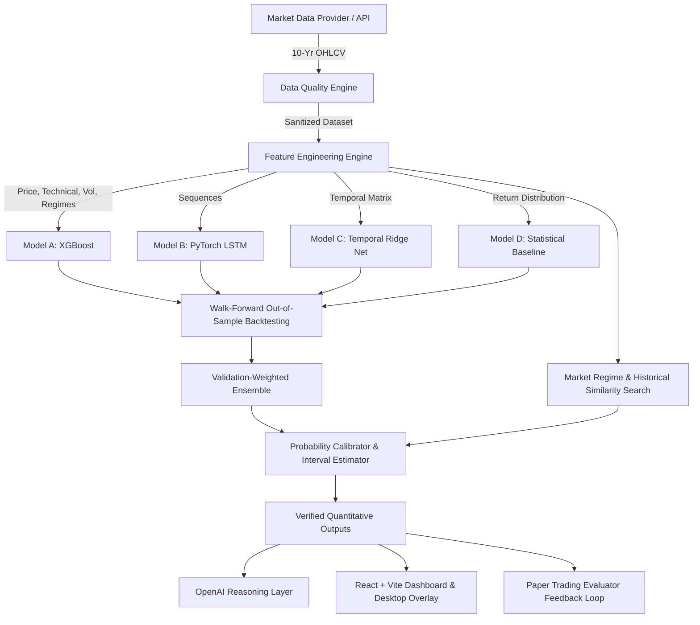

# TradeAI System Architecture & Engineering Specifications

TradeAI is a real, data-driven AI trading analysis application designed to eliminate random, hardcoded, or fabricated market predictions. Every forecast shown to the user is dynamically generated from actual historical and current market data using a multi-model machine learning ensemble.

---

## Architecture Flow Diagram

---

## Key Subsystems

### 1. Market Data Fetcher & Verification
- Verifies ticker symbols (`BTC/USDT`, `ETH/USDT`, `RELIANCE.NS`, `TCS.NS`, `^NSEI`, `AAPL`, `TSLA`).
- Refuses to predict if ticker is unidentified or invalid: outputs `"Unable to reliably identify the trading instrument. Please select the asset manually."`
- Fetches up to 10 years of historical data and reports exact available range (e.g. `7.8 years available`).

### 2. Data Quality Engine
- Audits missing candles, duplicate timestamps, invalid OHLC logic ($High < Low$, $High < Open$, etc.), extreme spikes, zero volume.
- Formats DATA SOURCE, DATA PERIOD, DATA FREQUENCY, NUMBER OF CANDLES, LAST UPDATE TIME.

### 3. Feature Engineering & Anti-Data Leakage
- 20+ features: Returns, Log returns, Rolling Volatility, ATR(14), SMA(20,50,200), EMA(9,21), RSI(14), MACD, Bollinger Bands, VWAP, Stochastic (%K,%D), ADX(14), CCI(20), RVOL, Breakout/Breakdown signals, Trend Strength.
- Strict past-only indexing (`shift(1)` operations) to eliminate lookahead bias.

### 4. Multi-Model Ensemble
- **Model A**: XGBoost Gradient Boosting for tabular feature matrices.
- **Model B**: PyTorch LSTM sequential neural network for sequence windows.
- **Model C**: Temporal Ridge / Feature Attention network.
- **Model D**: Statistical Baseline (Parametric return distribution + Random Walk drift).

### 5. Walk-Forward Out-of-Sample Backtesting
- Evaluates models on strict unseen test splits.
- Computes Directional Accuracy, Precision, Recall, F1, Sharpe Ratio, Profit Factor, Max Drawdown.
- Compares model performance explicitly against the Statistical Baseline.

### 6. Probabilities & Prediction Intervals
- Probability Calibration (UP %, DOWN %, SIDEWAYS %) via Softmax scaling.
- 50%, 80%, 95% Prediction Price Ranges calculated using residual error standard deviations ($Price_{latest} \pm z \cdot \sigma_{residual}$).
- Multi-horizon forecasts (5m, 15m, 30m, 1h, 4h, 1d, 5d).

### 7. Historical Similarity Engine & Regime Classifier
- K-Nearest Neighbors (k-NN) vector search matching current feature vector against historical sliding windows.
- Reports similar historical matches found, positive, negative, and neutral outcome counts.

### 8. OpenAI Reasoning Layer
- Accepts OpenAI API key, passes verified quantitative outputs to GPT-4o.
- Strictly forbidden from modifying numerical predictions or probabilities.

### 9. Transparent Desktop Overlay & Paper Trading
- Floating translucent window view for desktop trading screens.
- Paper trading feedback dataset logger to audit real-world prediction accuracy over time.
